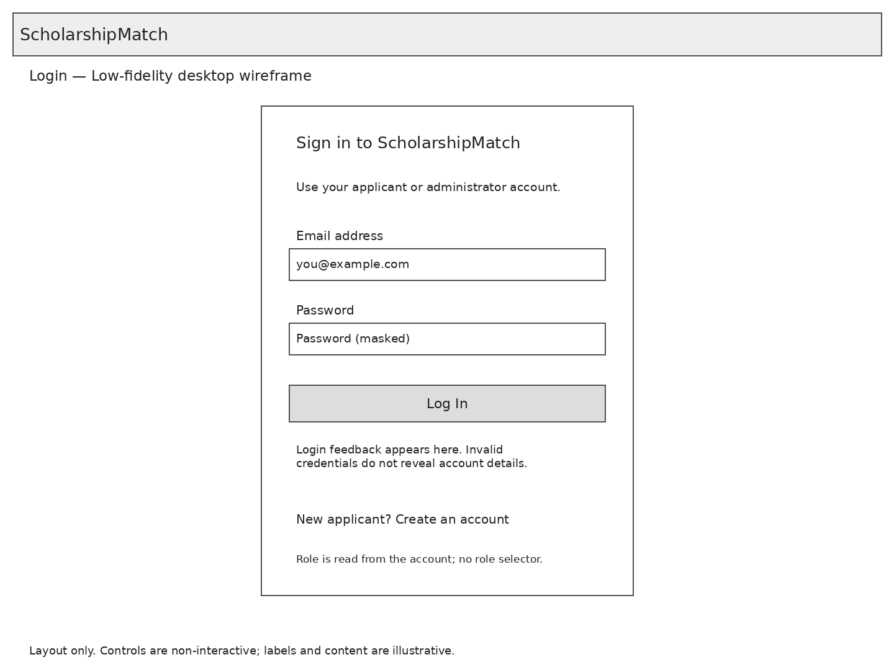
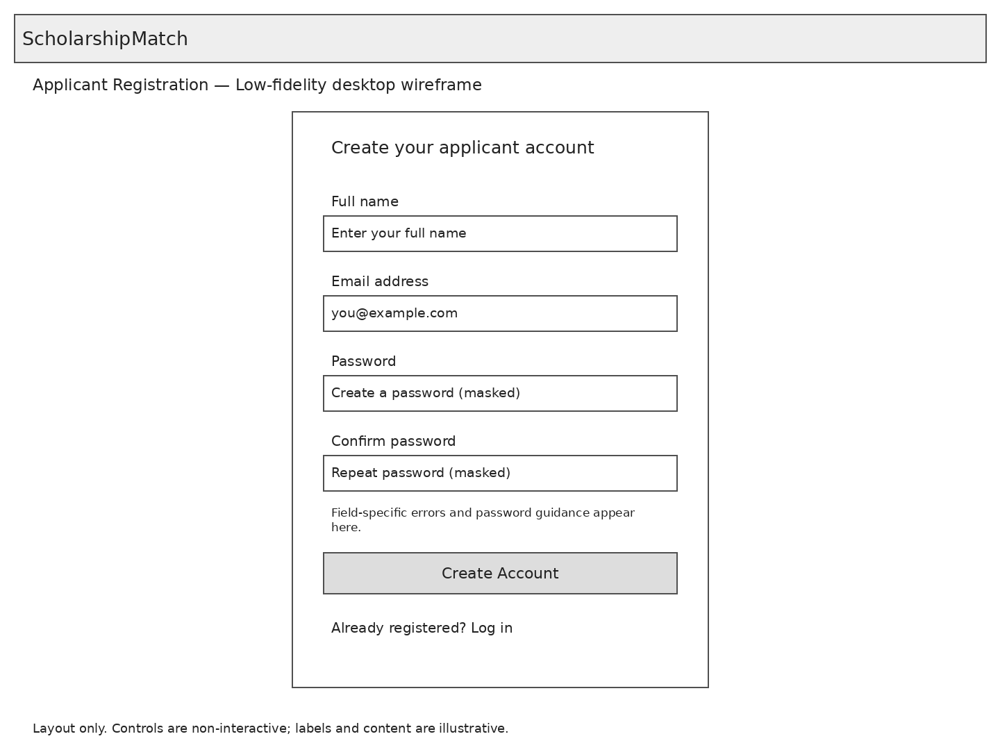
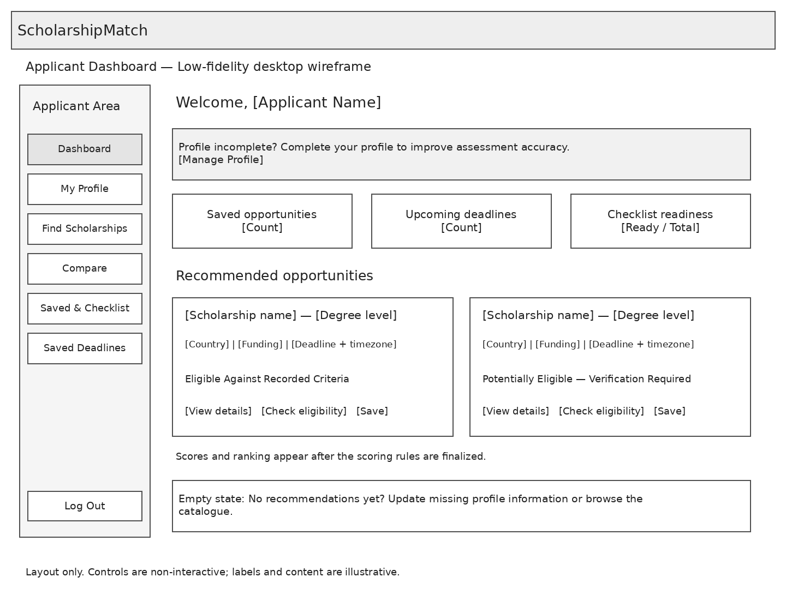
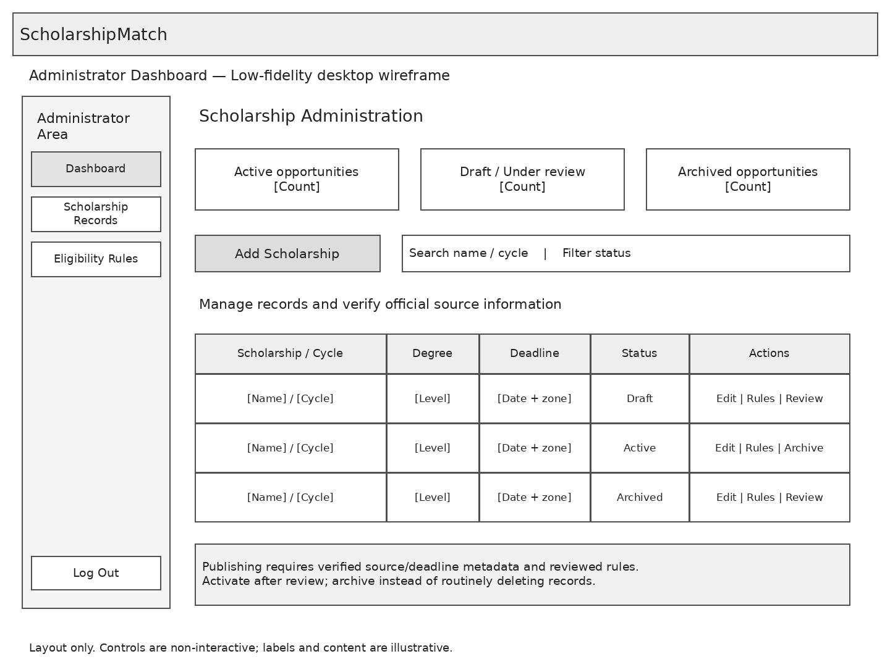

# ScholarshipMatch — Initial UI Wireframes

| Field | Value |
| --- | --- |
| Student / Registration | Syeda Alysha Aly / F24-BSSE-110 |
| Stage | 5C — Interface Design |
| Version / Date | 0.1 / 20 October 2026 |
| Status | Four initial low-fidelity desktop layouts; not implemented screens |

## Purpose

These wireframes plan page structure and role-specific navigation before HTML/CSS implementation. They are deliberately grayscale. Placeholder counts, opportunity names and statuses are illustrative, not live data or measured results.

## Screens

### Login

One login form accepts credentials for either role. The backend reads the stored role and opens the appropriate dashboard. There is no role selector. Invalid credentials produce a controlled generic message; authenticated sessions and backend authorization are required. Password-reset email is not part of this initial layout.

### Applicant Registration

Collect full name, email, password and confirmation. Password confirmation is transient and is not stored. Validate on the server, reject duplicate email addresses and hash passwords before persistence. Public registration creates applicants only. After success, direct the applicant to log in; the exact password policy must be defined before coding acceptance.

### Applicant Dashboard

Show a profile-completion prompt, saved/preparation summaries and explained recommendation labels. Country and funding preferences do not override mandatory failures. Potentially eligible results are explicitly marked as requiring verification. The displayed cards do not finalize score weights or grouping policy. Empty-state guidance must replace unavailable data rather than implying that a zero or fabricated score has been computed.

### Administrator Dashboard

Show record counts, search/filter controls and Add Scholarship, Edit, Rules, Review/Activate and Archive workflows. An administrator does not edit applicant profiles through this screen. The sample row actions are shorthand navigation placeholders; activation must require complete source metadata and reviewed criteria. Backend authorization is required even if controls are hidden from applicants.

## Editing and Repository Placement

Open [scholarshipmatch-wireframes.drawio](scholarshipmatch-wireframes.drawio) in diagrams.net. It contains one editable page per screen. PNGs are viewable exports of the planned layouts; Draw.io may wrap labels slightly differently after editing.

Keep this folder under `docs/wireframes/`. This README belongs inside the wireframes folder and does not replace the repository's root README. No front-end code or interactive navigation is included in this package.

## Traceability

| Screen | Use cases | Requirements |
| --- | --- | --- |
| Login | UC-02 | FR-01 |
| Registration | UC-01 | FR-01 |
| Applicant dashboard and navigation | UC-03–UC-11 | FR-02, FR-05–FR-11 |
| Administrator dashboard and navigation | UC-03, UC-12, UC-13 | FR-01, FR-03, FR-04 |

## Remaining Interface Work

The following layouts remain to be designed; this package does not complete all interface design:

1. Applicant profile with qualifications, tests and preferences.
2. Scholarship catalogue and detail page with official source information.
3. Eligibility result with passed, failed and unresolved checks.
4. Side-by-side scholarship comparison.
5. Saved opportunities, document readiness and deadline view.
6. Administrator scholarship-entry/edit form and rule configuration.
7. Mobile layouts and keyboard/focus/error states during implementation.

All screens will need server-side validation, accessible labels and controls, CSRF protection for state-changing forms and responsive verification. Wireframes do not prove these requirements have been implemented. Once the remaining layouts and open policies are settled, implement the authentication slice with MySQL and Flask in small tested increments.
